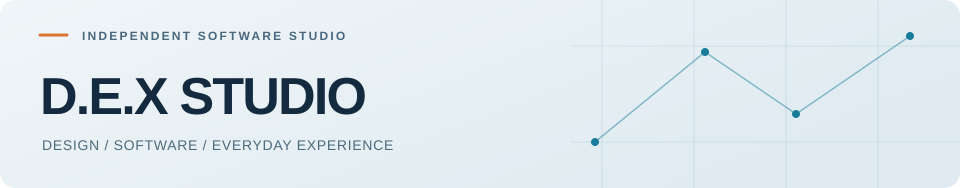
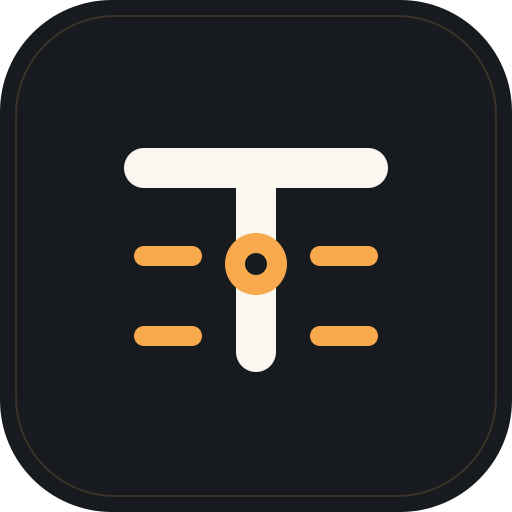
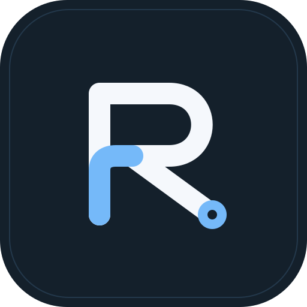

<picture>
  <source media="(max-width: 768px) and (prefers-color-scheme: dark)" srcset="assets/studio-header-dark-mobile.svg">
  <source media="(max-width: 768px)" srcset="assets/studio-header-light-mobile.svg">
  <source media="(prefers-color-scheme: dark)" srcset="assets/studio-header-dark.svg">
  <source media="(prefers-color-scheme: light)" srcset="assets/studio-header-light.svg">
  
</picture>

为日常，构建更好的数字体验。 
Thoughtful software for everyday life.

**[软件状态与下载 / Software hub →](https://github.com/dex-ovo-studio/DEX-Studio-Software-Status)** · [软件 / Products](#products) · [支持 / Support](#support)

专注创造，持续探索。 
Building thoughtfully. Exploring continuously.

---

## 软件 / Software

###  Navio
让连接与日常管理更清晰。Windows 代理、规则与连接管理。 
A clearer workspace for connections, profiles and rules. 
**公开 Beta / Public beta · Windows x64** 
已公开 Beta 7；下载前请阅读系统代理恢复的已知问题。RC4、RC5 与 1.0 Stable 尚未公开。 
Beta 7 is published. Read the proxy-restoration advisory before downloading. RC4, RC5 and 1.0 Stable are not published. 
[项目介绍](https://github.com/dex-ovo-studio/Navio) · [版本下载](https://github.com/dex-ovo-studio/Navio/releases) · [使用指南](https://github.com/dex-ovo-studio/Navio/blob/main/docs/guide.md)

---

###  Mystery
给日常，多一点期待。盲盒与抽奖桌面体验。 
A little surprise, every day. 
**公开版本 / Published release · 2.1.0** 
安装包与校验文件由 Mystery 产品仓的发行页提供。以该发布页的说明和实际附件为准。 
The Mystery release page provides the installer and checksum file. Check its release notes and assets. 
[官网](https://mystery.mydex.top) · [项目介绍](https://github.com/dex-ovo-studio/Mystery) · [版本下载](https://github.com/dex-ovo-studio/Mystery/releases/tag/mystery-v2.1.0) · [使用指南](https://github.com/dex-ovo-studio/Mystery/blob/main/docs/guide.md)

---

###  Tune
掌控系统，随身而行。便携式 Windows 调试工作台。 
A portable workspace for Windows tuning. 
**开发中 / In development · 暂无公开安装包 / No public installer** 
[项目介绍](https://github.com/dex-ovo-studio/Tune) · [开发进展](https://github.com/dex-ovo-studio/Tune/blob/main/STATUS.md)

---

###  Rovelio · 驭途
为每段骑行，探索更清晰的交互。摩托车机与语音交互实验。 
Exploring a clearer motorcycle dashboard experience. 
**开发中 / In development · 暂无公开镜像 / No public image** 
[项目介绍](https://github.com/dex-ovo-studio/Rovelio) · [开发进展](https://github.com/dex-ovo-studio/Rovelio/blob/main/STATUS.md)

发行信息核对于 / Release information checked on 2026-11-17. Tune 与 Rovelio 暂沿用现有仓库入口 / Existing repository URLs are retained for Tune and Rovelio.

---

## 下载与支持 / Downloads & support

软件的可用版本、开发状态与官方入口统一收录于[软件状态与下载](https://github.com/dex-ovo-studio/DEX-Studio-Software-Status)。 
Find current availability, official downloads and guides in the [software hub](https://github.com/dex-ovo-studio/DEX-Studio-Software-Status).

产品反馈 / Product issues：[Navio](https://github.com/dex-ovo-studio/Navio/issues) · [Mystery](https://github.com/dex-ovo-studio/Mystery/issues) · [Tune](https://github.com/dex-ovo-studio/Tune/issues) · [Rovelio](https://github.com/dex-ovo-studio/Rovelio/issues)。

合作与一般咨询可通过[工作室反馈入口](https://github.com/dex-ovo-studio/DEX-Studio-Software-Status/issues)联系。涉及安全或账号信息时，勿在公开 Issue 中填写敏感资料；Navio 请先阅读[安全报告说明](https://github.com/dex-ovo-studio/Navio/blob/main/SECURITY.md)。 
For collaboration or general enquiries, use the [studio contact issue tracker](https://github.com/dex-ovo-studio/DEX-Studio-Software-Status/issues). Do not post sensitive information in public Issues; see [Navio security guidance](https://github.com/dex-ovo-studio/Navio/blob/main/SECURITY.md) for Navio reports.

各产品的许可证、源码与使用条件以对应仓库和发布页为准。图标与页头是品牌素材，非应用运行截图。 
Licenses, source availability and terms are specific to each repository and release. The artwork is branding, not application screenshots.
