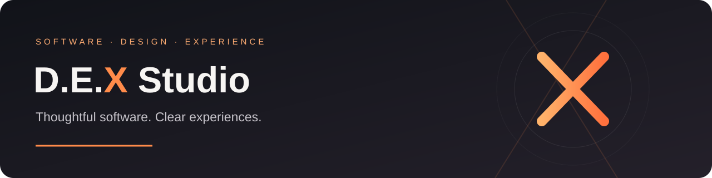

### 用清晰的设计，做好日常软件。

Thoughtful software. Clear experiences.

## [软件状态与下载 →](https://github.com/dex-ovo-studio/DEX-Studio-Software-Status)

**[Start here · Software status & downloads](https://github.com/dex-ovo-studio/DEX-Studio-Software-Status)**

第一次来？从这里查看全部软件与官方下载。  
New here? Find all our software and official downloads here.

---

## 精选项目 · Selected projects

| 项目 / Project | 简介 / Overview |
| :--- | :--- |
| **[Navio](https://github.com/dex-ovo-studio/Navio)** | 让连接、配置与日常管理更清晰。 A clearer workspace for Windows proxy management. |
| **[Mystery](https://github.com/dex-ovo-studio/Mystery)** | 盲盒与抽奖桌面软件，为日常增添一点期待。 A mystery box and lucky draw desktop experience. |
| **[Tune](https://github.com/dex-ovo-studio/DEX-TUNE)** | 随 U 盘携带的 Windows 调试工作台。 A portable Windows tuning workspace. |
| **[Rovelio · 驭途](https://github.com/dex-ovo-studio/DEX-Rider)** | 为骑行打造的车机与语音交互体验。 A motorcycle dashboard with music, maps and voice in mind. |

## 我们的方向 · Our approach

**清晰 / Clarity** — 让信息易读，让操作容易理解。  
Readable information and understandable controls.

**实用 / Utility** — 围绕真实场景打磨，说明已完成的能力与边界。  
Build for real use, with clear capabilities and limitations.

**一致 / Consistency** — 统一的视觉语言，保留每个项目的个性。  
A shared visual language, with room for each project's character.

---

D.E.X Studio · 软件 / Software · 设计 / Design · 体验 / Experience

